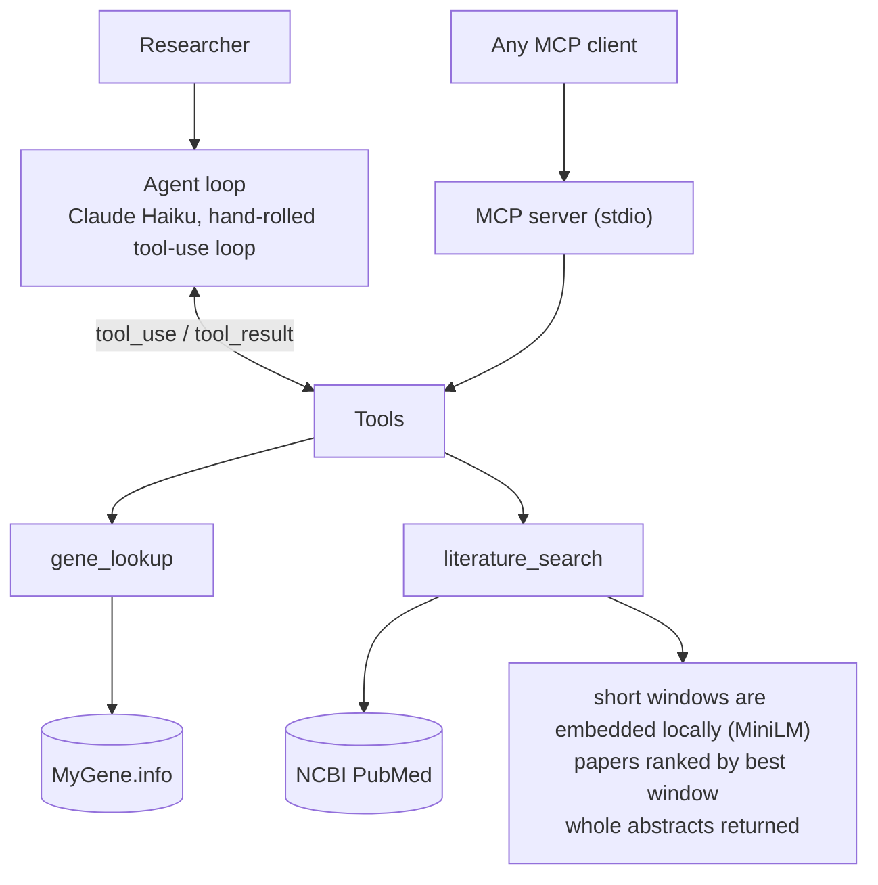

# Gene Triage Assistant

An agent that helps a researcher investigate a **human gene**: it looks the gene up in MyGene.info, retrieves
relevant PubMed papers, and answers from what it retrieved instead of from memory. Built from scratch on the
raw Anthropic SDK (no agent framework) as an MSc portfolio project, with the evaluation work treated as
seriously as the agent.

**Status:** working end to end. On my 12-case evaluation the agent passes every tool-use and citation check
but only 8 of 12 groundedness checks, and I report that openly (see [Results](#results)). It does not look
up *variants* (no ClinVar); see [Limitations](#limitations).

## What it demonstrates

| Skill | Where to look |
|---|---|
| Tool / function calling | [`agent/loop.py`](src/gta/agent/loop.py): hand-rolled loop with parallel calls, `is_error` recovery, truncation and iteration limits. [`examples/raw_tool_calling.py`](examples/raw_tool_calling.py) shows the bare mechanism in ~100 lines |
| Prompt engineering | The system prompt, the tool descriptions (the only thing the model sees of a tool), and the judge rubric: [`prompts.py`](src/gta/agent/prompts.py), [`tool_specs.py`](src/gta/agent/tool_specs.py), [`eval/judge.py`](src/gta/eval/judge.py) |
| Retrieval-augmented generation | [`tools/literature_search.py`](src/gta/tools/literature_search.py), [`rag/`](src/gta/rag): small-to-big retrieval, with window size chosen by measuring the embedder's input limit |
| MCP | [`mcp_server/`](src/gta/mcp_server): a stdio server exposing the same tools, plus a client that launches and probes it |
| Evaluation | [`eval/`](src/gta/eval): record/replay fixtures, deterministic checks, an LLM judge with severity ratings, and a calibration run against planted errors |
| Testing | 71 offline tests, with the guards checked by deliberately re-introducing the bugs they prevent |

## Example

Excerpts from a recorded evaluation run:

```
> What does p53 do?
  tool call: gene_lookup(symbol='TP53')        <- resolved the alias "p53" to the official symbol

  TP53 (tumor protein p53, commonly called "p53") is a tumor suppressor gene that encodes a
  protein with several critical cellular functions:
  - Transcriptional activation and DNA binding
  - Stress response, cell cycle arrest, apoptosis, senescence ...
  [...]
  Mutations in TP53 are associated with various human cancers, including Li-Fraumeni syndrome ...

> What does the gene FAKEGENE321 do?
  tool call: gene_lookup(symbol='FAKEGENE321')

  The gene symbol "FAKEGENE321" does not appear to be a valid human gene. The lookup returned no results.
```

## How it works



- The agent and the MCP server are two front doors onto the same tool functions.
- Failures are handled in three different ways: "gene not found" is a normal result, a crashing or misused
  tool is returned to the model as an error it can recover from, and a rejected API key stops the run.
- Evaluation replays recorded tool outputs, so a score change reflects the agent and not PubMed changing.

## Results

12 hand-written cases, one run, fixtures replayed, judge: Claude Sonnet.

| Measure | Result |
|---|---|
| Tool-call and citation checks | 12/12 |
| Behaviour rubrics (admits unknown genes, resists a planted prompt injection, declines dosing advice, ...) | 12/12 |
| **Grounded** (no major unsupported or overstated claim) | **8/12** |

The judge was calibrated on 8 answers with planted errors of known type (each judged 3 times): it caught all
of them, including a dropped "not tested" qualifier, and flagged neither faithful control. That is a sanity
check, not a validation: the answers were short, synthetic and limited to the seeded error types.

Twelve cases cannot support statistical claims, so treat this as a regression tripwire.

## Limitations

- **Genes, not variants.** Nothing queries ClinVar, and the agent cannot resolve an rsID or HGVS name. Asked
  whether a named variant is pathogenic, it answers from papers that mention it and does not say that this is
  not an authoritative classification.
- **Grounding is imperfect.** The agent sometimes adds facts from memory, overstates how strong the evidence
  is, or turns an empty search into "there is no evidence". The evaluation exists to measure this.
- **MCP server tested only with the bundled Python client**, not yet from Claude Desktop.

Details, the production gaps, and the reasoning behind each design choice are in
[`docs/DESIGN.md`](docs/DESIGN.md).

## Quickstart

Requires Python 3.10+ (developed on 3.11; `.python-version` pins it).

```bash
python -m venv .venv && source .venv/bin/activate
pip install -r requirements.txt           # ~1 GB: sentence-transformers pulls in PyTorch
cp .env.example .env                      # then add your Anthropic API key
```

```bash
python -m src.gta.agent.loop                       # ask the agent questions (blank line quits)
python -m src.gta.mcp_server.client_demo           # launch the MCP server and probe it
pip install -r requirements-dev.txt && python -m pytest -q       # 71 offline tests
python -m src.gta.eval.runner --no-judge           # replay the eval: tool + citation checks, no judge cost
python -m src.gta.eval.runner                      # full eval including the LLM judge
python -m src.gta.eval.calibration                 # check the judge against planted errors
```

The first literature search downloads an ~80 MB embedding model. Only the agent and the judge call the
Anthropic API; the MCP server needs no key.

## Layout

```
src/gta/
  tools/        gene_lookup, pubmed_search, literature_search
  rag/          chunking, embeddings, retrieval
  agent/        loop, tool_specs, prompts
  mcp_server/   server (FastMCP, stdio), client_demo
  eval/         cases, checks, recording (record/replay), judge, calibration, runner
examples/       raw_tool_calling: the bare tool-use mechanism
tests/          offline unit tests
eval_data/      tool_cache: recorded tool outputs used for replay
docs/           DESIGN.md
```
