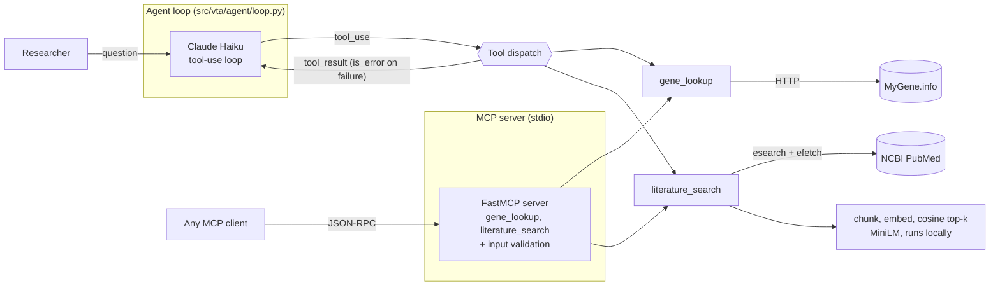
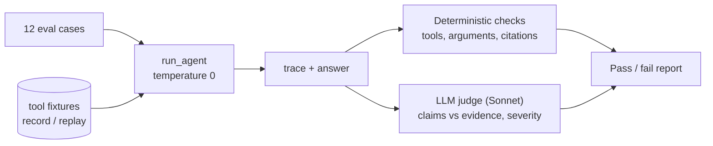

# Variant Triage Assistant

An agent that helps a researcher investigate a human gene by calling public biomedical APIs, retrieving
literature, and answering from what it retrieved rather than from memory. Built from scratch on the raw
Anthropic SDK (no agent framework) to understand every mechanism: tool calling, the agent loop,
retrieval-augmented generation, an MCP server, and an evaluation harness.

Scope: **human genes**. The tools work at the gene level: `gene_lookup` takes official gene symbols, and
`literature_search` is free-text PubMed retrieval. **Nothing queries a variant database.** The agent cannot
look up or resolve a variant (an rsID, or an HGVS name such as `c.5266dupC`) and has no access to ClinVar
classifications (pathogenic, benign, uncertain significance).

If you ask about a specific variant, the agent will still answer, using whatever retrieved papers say about
it, and it does **not** currently tell you that it has no authoritative classification. See
[Known issues](#known-issues-in-the-agent-found-by-the-harness-not-yet-fixed). Adding ClinVar is the
intended fix; see [Extending](#extending).

## Architecture



The agent and the MCP server are two front doors onto the same tool functions.

### Evaluation harness



## Setup

Requires Python 3.10+ (developed on 3.11.9 via pyenv; `.python-version` pins it).

```bash
python -m venv .venv
source .venv/bin/activate
pip install -r requirements.txt        # ~1 GB: sentence-transformers pulls in PyTorch
cp .env.example .env                   # then put your Anthropic API key in .env
```

The first literature search downloads the ~80 MB embedding model. The MCP server itself needs no API key;
only the agent and the judge call the Anthropic API.

## Usage

Interactive agent (blank line quits):

```bash
python -m src.vta.agent.loop
```

MCP server, and a client that launches it, lists its tools and probes the input validation:

```bash
python -m src.vta.mcp_server.server        # stdio; normally launched by an MCP client
python -m src.vta.mcp_server.client_demo
```

An MCP client such as Claude Desktop would need an entry like the following in its config. **This has not
been tested against a real client yet**; only the bundled Python client has been used.

```json
{
  "mcpServers": {
    "variant-triage": {
      "command": "/absolute/path/to/.venv/bin/python",
      "args": ["-m", "src.vta.mcp_server.server"],
      "env": { "PYTHONPATH": "/absolute/path/to/variant-triage-assistant" }
    }
  }
}
```

Tests (50, all offline and deterministic):

```bash
pip install -r requirements-dev.txt
python -m pytest -q
```

Evaluation:

```bash
python -m src.vta.eval.runner --no-judge             # free of judge cost: tool + citation checks, fixtures replayed
python -m src.vta.eval.runner                        # full run including the LLM judge
python -m src.vta.eval.runner --mode record          # refresh fixtures from the live APIs
python -m src.vta.eval.calibration                   # does the judge catch planted errors?
python -m src.vta.eval.runner --baseline eval_results/<earlier>.json   # diff outcomes against a prior run
```

## Design decisions

| Decision | Chosen | Rejected, and why |
|---|---|---|
| Agent framework | Hand-rolled loop on the raw SDK | LangChain/LangGraph: hides the stop-reason and message-history mechanics this project exists to learn |
| Gene source | MyGene.info, one call with `fields=` | Ensembl REST: lower level (coordinates, transcripts); would need several calls for "what does this gene do" |
| Literature | PubMed E-utilities (esearch then efetch) | A paper-aggregator API: extra account and dependency, no gain |
| Tool failures | Return `{"found": false, "error": ...}` as normal content; `is_error` only for crashes or misuse | Raising exceptions: would crash the loop instead of letting the model see and handle the failure |
| Chunking | One abstract = one chunk; overlapping windows only above 220 words | Fixed 512-token windows: would split a claim from its evidence inside a 250-word abstract |
| Retrieval | Fetch ~15 candidates by PubMed's lexical ranking, then cosine re-rank to top-k with a similarity floor | Dump all abstracts in context: cost scales with what is fetched, and irrelevant text degrades answers |
| Vector store | Plain numpy dot product over unit-normalised vectors | Chroma/FAISS: at tens of chunks per query they add dependencies and hide the mechanism |
| Embeddings | `all-MiniLM-L6-v2` via sentence-transformers, local | Hosted embeddings: another account and key |
| MCP transport | stdio | Streamable HTTP: needs auth and deployment, which are out of scope |
| MCP SDK | `mcp` 1.30.0 (`FastMCP`) | 2.x: new `MCPServer` API; not evaluated, so not claimed to be a small migration |
| Judge model | Sonnet 5.5 | Same model as the agent: shared blind spots and self-preference |
| Eval determinism | Record/replay of tool outputs, `temperature=0` for the agent, judge verdicts cached by input hash | Live APIs every run: PubMed drifts, so a score change could not be attributed |

### Things worth knowing

- **Schema is prompt engineering.** The model sees only each tool's name, description and JSON schema.
  The MCP server reuses the descriptions from `tool_specs.py` so that wording has one source of truth.
- **MCP derives its public schema from the Python signature**, so a parameter on the function becomes a
  parameter any client can set. `fetch_n` is deliberately not on the MCP tool for that reason, and
  `symbol` is pattern-restricted because it is interpolated into a MyGene.info query string.
- **Sonnet 5.5 accepts neither `temperature` nor a forced `tool_choice`.** The judge is therefore not
  deterministic, which is why its verdicts are cached and its variance is measured in calibration.

## Evaluation: what it measures, and what it can't

**Tool-call correctness** (deterministic, from the trace): required tools called, forbidden tools not
called, argument checks (e.g. an alias like p53 must become the symbol `TP53`), no unrecovered tool errors,
bounded tool budget.

**Groundedness**, in two layers, because a real PMID can still carry an unfaithful claim:
1. *Citation validity* (deterministic): every PMID in the answer must have been returned by a search.
2. *Claim-level faithfulness* (LLM judge): each claim is checked against only the retrieved evidence and
   rated supported / overstated / unsupported / contradicted with a major or minor severity. A case fails
   only on a major issue. The judge must quote the evidence, and the code verifies the quote exists.

**Latest results** (12 dev cases, one run, default prompt, fixtures replayed):

| Measure | Result |
|---|---|
| Tool-call and citation checks | 12/12 |
| Grounded, per the judge | 9/12 |
| Behaviour rubrics | 12/12 |

**Judge calibration:** 8 answers with planted faults of known type (fabricated number, contradiction, the
dropped "not tested" qualifier, true-but-unsourced claim, wrong PMID, overstated consensus) plus 2 faithful
controls, each judged 3 times: 24/24 judgements correct, no disagreement across repeats. This is a sanity
check, not a validation. The answers are short and synthetic, only the seeded fault types are covered, and
the major/minor boundary itself is not calibrated.

**Limits to state plainly.** Twelve cases cannot give statistical confidence, so treat the harness as a
regression tripwire and not a benchmark. The cases were written and adjusted by the same person building
the agent. One case (`mouse_gene_species`) was found to be wrong by running the eval and was corrected.
The severity rubric was introduced after the first judged run, and its effect on outcomes is visible in the
saved results (some cases went from fail to pass, and one went from pass to fail).

## Known issues in the agent (found by the harness, not yet fixed)

The harness shows the agent does not reliably follow its own grounding instruction. Observed in judged runs.
These come from reading the judge's per-claim explanations; apart from the "no published evidence" and
tool-outage cases, which are visible in the answers themselves, I did not re-verify each one against the raw
abstracts, so treat the judge's reading as the source:

- Adds mechanisms, examples and disease associations from memory (e.g. synthetic lethality for PARP
  inhibitors, Li-Fraumeni details) that are not in any tool result.
- Overstates the strength of evidence ("substantial", "strong", "recent") for modest or old studies, and
  presents "broad efficacy" while omitting variants that did not respond.
- Claimed a result ("showed responsiveness") where, per the judge, the retrieved text described only a
  trial's design.
- Turns an empty search into "there is no published evidence", which is a claim about the literature and
  not about the search.
- After a simulated tool outage, sometimes answers from memory instead of saying the lookup failed.
- **Variant questions are answered without a caveat.** Seen in one manual test, not in the eval suite (no
  case covers it, and the judge was not run on it): asked whether a named BRCA1 variant is pathogenic, the
  agent made one literature search and answered "yes" on the basis of two papers that mention the variant,
  then added mechanistic reasoning that appears in no retrieved text. A paper mentioning a variant is not a
  classification, so this approach cannot distinguish a pathogenic variant from one of uncertain
  significance, and it never says so.

### Planned improvement (not built)

Tighten the system prompt against exactly these failure types, tune it on the 12 dev cases only, and
check a separate held-out split of new genes and topics, so the gain is not just memorisation of the dev
cases. Success is judged by the harness against the baseline above.

The same round should add a rule that, for variant-classification questions, the agent states it cannot look
up classifications and is reporting only what papers say, plus an eval case that checks it. That is a
stopgap. The real fix is a ClinVar tool (below).

## Production gaps (simplified for scope)

- **Retrieval:** the index is rebuilt on every call, with no persistence or caching, so papers are
  re-fetched and re-embedded each time. Production wants a persistent vector index (pgvector, Qdrant,
  FAISS) and a cross-encoder re-ranker on top of the bi-encoder.
- **Thresholds untuned:** the 0.3 similarity floor was chosen by feel, not against labelled relevance data.
- **Rate limits:** NCBI allows ~3 requests/s without a key; there is no throttling or shared limiter, which
  matters once several MCP clients share one server. A free NCBI API key raises the limit.
- **MCP:** stdio only; no authentication, no multi-tenancy, no remote transport. Packaging uses `src.`
  imports relying on the working directory or `PYTHONPATH`; a `pyproject.toml` with an editable install is
  the proper fix.
- **Prompt injection:** retrieved abstracts are untrusted text placed in the model's context. An eval case
  plants an instruction in an abstract and checks the agent does not obey it, but one case is not a defence.
  There is no content filtering or output validation.
- **Evaluation:** no CI integration; tiny sample; fixtures go stale and need scheduled re-recording; replay
  misses if the model words a query differently from the recording; judge cost and bias are only partly
  measured; no human-labelled gold set; no monitoring of real usage.
- **Observability:** token usage is reported per run, but there is no tracing, latency budget or cost cap.
- **Models and APIs:** model IDs are pinned in code; MyGene.info returns inconsistent types (e.g.
  `entrez_id` as a string), handled only by passing values through.

## Extending

- **ClinVar / variants (the main missing capability):** add `clinvar_lookup` as a pure function returning
  the same `{"found": ...}` shape, register it in `tool_specs.py`, and the agent loop needs no changes; the
  MCP server needs one decorated wrapper and the eval harness needs new cases. Not built, so the claim that
  it slots in cleanly is a design intent, not something demonstrated here.
- **Agent as an MCP client:** make `loop.py` discover its tools from the server instead of importing them,
  so the server is the only place tools are defined.

## Layout

```
src/vta/
  tools/        gene_lookup, pubmed_search, literature_search
  rag/          chunking, embeddings, retrieval
  agent/        loop (hand-rolled tool-use loop), tool_specs, prompts, stage1 (raw first demo)
  mcp_server/   server (FastMCP, stdio), client_demo
  eval/         cases, checks, recording, judge, calibration, runner
tests/          offline unit tests (50)
eval_data/      tool_cache (recorded fixtures), judge_cache
```
