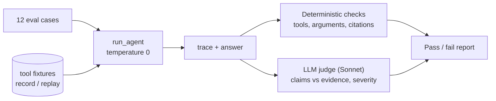

# Design notes

How the Gene Triage Assistant is built, why, what it measures, and where it falls short. The
[README](../README.md) is the short version.

## Evaluation harness

## Design decisions

| Decision | Chosen | Rejected, and why |
|---|---|---|
| Agent framework | Hand-rolled loop on the raw SDK | LangChain/LangGraph: hides the stop-reason and message-history mechanics this project exists to demonstrate. The trade-off is no framework fluency to show |
| Gene source | MyGene.info, one call with `fields=` | Ensembl REST: lower level (coordinates, transcripts); several calls for "what does this gene do" |
| Literature | PubMed E-utilities (esearch, then efetch) | A paper-aggregator API: extra account and dependency, no gain |
| Tool failures | "Gene not found" is a normal `{"found": false}` result; `is_error` only for crashes or misuse; a rejected API key raises | Raising for everything: crashes the loop instead of letting the model see and handle the failure |
| Input validation | Inside the tool functions; the MCP schema imports the same constants | Validating only in the MCP wrapper, which is what this project first did (see below) |
| Retrieval | Small-to-big: embed ~80-word windows (title prepended), rank papers by best window, return whole abstracts | Dumping all abstracts in context (cost scales with what is fetched, irrelevant text degrades answers); returning windows (fragments that start mid-sentence) |
| Vector store | Plain numpy dot product over unit-normalised vectors | Chroma/FAISS: at tens of windows per query they add dependencies and hide the mechanism |
| Embeddings | `all-MiniLM-L6-v2` via sentence-transformers, local | Hosted embeddings: another account and key |
| MCP transport | stdio | Streamable HTTP: needs auth and deployment, out of scope |
| MCP SDK | `mcp` 1.30.0 (`FastMCP`) | 2.x has a new `MCPServer` API; not evaluated, so no claim about migration cost |
| Judge model | Sonnet 5.5 | The agent's own model: shared blind spots and self-preference |
| Eval determinism | Record/replay of tool outputs; `temperature=0` for the agent; judge verdicts cached by input hash (not committed) | Live APIs every run: PubMed drifts, so a score change could not be attributed |

Two constraints shaped the judge: Sonnet 5.5 accepts neither `temperature` nor a forced `tool_choice`, so the
judge is not deterministic. Its variance is measured in calibration and its verdicts are cached.

## Retrieval

The tool functions are small; the interesting part is the chunking, which was wrong at first.

- `all-MiniLM-L6-v2` reads only the first 256 word-pieces and silently ignores the rest. This text runs
  ~1.7 word-pieces per word, so ~150 words is the most that fits.
- The first version used 220-word windows. Measured on 192 real abstracts, **60% of windows overflowed** the
  limit, so many were ranked without their tail, often the results section. (Between 35% and 79% of real
  abstracts exceed 220 words depending on the topic, so "split only unusually long abstracts" was also false.)
- The fix: windows of 80 words with 20 of overlap and the paper title prepended, which overflow 0.7% of the
  time (95th percentile 200 tokens). The windows are only retrieval *keys*: a paper is scored by its best
  window and the **whole abstract** is returned, one entry per paper.
- **What is not measured:** retrieval quality. There is no labelled relevance set. After the change only 2-3
  of the 4-5 papers matched the old results for three test queries; read side by side, the new ones looked at
  least as on-topic for the HRT and CFTR queries and mixed for the PARP query. That is an informal check.
  The 0.3 similarity floor was never tuned, and adding the title shifted the score range upward.

## Evaluation

**Tool-call correctness** (deterministic, from the trace): required tools called, forbidden tools not called,
argument checks (an alias such as p53 must become `TP53`), no unrecovered tool errors, bounded tool budget.

**Groundedness**, in two layers, because a real PMID can still carry an unfaithful claim:

1. *Citation validity* (deterministic): every PMID in an answer must have been returned by a search.
2. *Claim-level faithfulness* (LLM judge): each claim is checked against only the retrieved evidence and rated
   supported / overstated / unsupported / contradicted, with a major or minor severity. A case fails only on a
   major issue. The judge must quote the evidence, and the code checks the quote exists.

The severity rubric was added after the first judged run showed that a flat "any unsupported claim fails"
rule failed cases over harmless elaboration. The rule was written down before re-running, and calibration was
re-run to confirm it did not let any planted error through.

**Judge calibration.** Eight answers with planted errors of known type (fabricated number, contradiction,
the dropped "not tested" qualifier, true-but-unsourced claim, wrong PMID, overstated consensus) plus two
faithful controls, each judged three times: 24/24 judgements correct, no disagreement across repeats. Limits:
the answers are short and synthetic, only the seeded error types are covered, and the major/minor boundary is
not itself calibrated.

**Limits of the harness.** Twelve cases cannot give statistical confidence. The cases were written and
adjusted by the person building the agent. Replay misses if the model words a query differently from the
recording. The judge's cost and bias are only partly measured.

## Problems the project found in its own work

Listed because they are the evidence that the checking is real.

- A test case (`mouse_gene_species`) required a tool call, but declining to call a human-only tool is equally
  valid. Found by running the eval; the case was corrected and the reason recorded.
- The judge's quote verifier rejected quotes containing `...`. A flaw in the check, not the judge.
- The chunk size exceeded the embedder's input limit (above). Found in a review of the whole project.
- Input protection existed only on the MCP path: the agent called `gene_lookup` directly, where `BRCA*`
  silently returned BRCA1. Now enforced in the tool functions and covered by tests. This is a robustness
  problem (wrong-gene answers), not a security hole: the upstream API is public and read-only.
- After the retrieval output changed, the prompt-injection eval silently turned into a tool-error eval,
  because its hook still used the old output key. A test now ties the hook to the real output shape.
- A new test passed even with the grouping code deleted, because its data could not produce duplicates. The
  test was strengthened until the deletion failed it.

## Known issues in the agent

Observed in judged runs, from reading the judge's per-claim explanations; apart from the "no published
evidence" and tool-outage cases, which are visible in the answers themselves, I did not re-verify each one
against the raw abstracts.

- Adds mechanisms, examples and disease associations from memory (e.g. synthetic lethality for PARP
  inhibitors, Li-Fraumeni details) that are in no tool result.
- Overstates the strength of evidence ("substantial", "strong", "recent", "suggests the opposite") for modest
  or old studies, drops qualifiers such as "short-term", and presents "broad efficacy" while omitting variants
  that did not respond.
- Claimed a result where, per the judge, the retrieved text described only a trial's design.
- Turns an empty search into "there is no published evidence", a claim about the literature, not the search.
- After a simulated tool outage, sometimes answers from memory instead of saying the lookup failed.
- **Variant questions are answered without a caveat.** Seen in one manual test, not in the eval suite: asked
  whether a named BRCA1 variant is pathogenic, the agent made one literature search and answered "yes" on the
  strength of two papers that mention the variant, then added mechanistic reasoning found in no retrieved
  text. A paper mentioning a variant is not a classification, so this approach cannot tell a pathogenic variant
  from one of uncertain significance, and it never says so.

### Planned improvement (not built)

Tighten the system prompt against exactly these failure types, tune it on the 12 cases only, and check a
separate held-out set of new genes and topics so the gain is not memorisation. Add a rule and an eval case
for variant questions (state that classifications cannot be looked up). Success is judged by the harness
against the baseline in the README.

## Production gaps (simplified for scope)

- **Retrieval:** the index is rebuilt on every call, with no persistence or caching, so papers are re-fetched
  and re-embedded each time. Production wants a persistent vector index (pgvector, Qdrant, FAISS) and a
  cross-encoder re-ranker. There is no retrieval-quality measurement and the similarity floor is untuned.
- **Rate limits:** NCBI allows about 3 requests/s without a key; there is no throttling or shared limiter,
  which matters once several MCP clients share one server. A free NCBI API key raises the limit.
- **MCP:** stdio only; no authentication, multi-tenancy or remote transport; tested only with the bundled
  client. Imports use `src.` paths relying on the working directory; a `pyproject.toml` with an editable
  install is the proper fix.
- **Prompt injection:** retrieved abstracts are untrusted text placed in the model's context. One eval case
  plants an instruction in an abstract and checks the agent does not obey it; that is a check, not a defence.
  There is no content filtering or output validation.
- **Evaluation:** no CI integration; tiny sample; fixtures go stale and need scheduled re-recording; no
  human-labelled gold set; no monitoring of real usage.
- **Observability:** token usage is reported per run, but there is no tracing, latency budget or cost cap.
- **Data:** MyGene.info returns inconsistent types (e.g. `entrez_id` as a string), handled only by passing
  values through. PubMed abstract text is committed as test fixtures; check NCBI's terms before redistributing.

## Extending

- **ClinVar / variants (the main missing capability):** add `clinvar_lookup` as a pure function returning the
  same `{"found": ...}` shape and register it in `tool_specs.py`. The agent loop should need no changes; the
  MCP server needs one decorated wrapper and the eval harness needs new cases. Not built, so the claim that it
  slots in cleanly is a design intent, not something demonstrated.
- **Agent as an MCP client:** make `loop.py` discover its tools from the server instead of importing them, so
  the server is the only place tools are defined.
